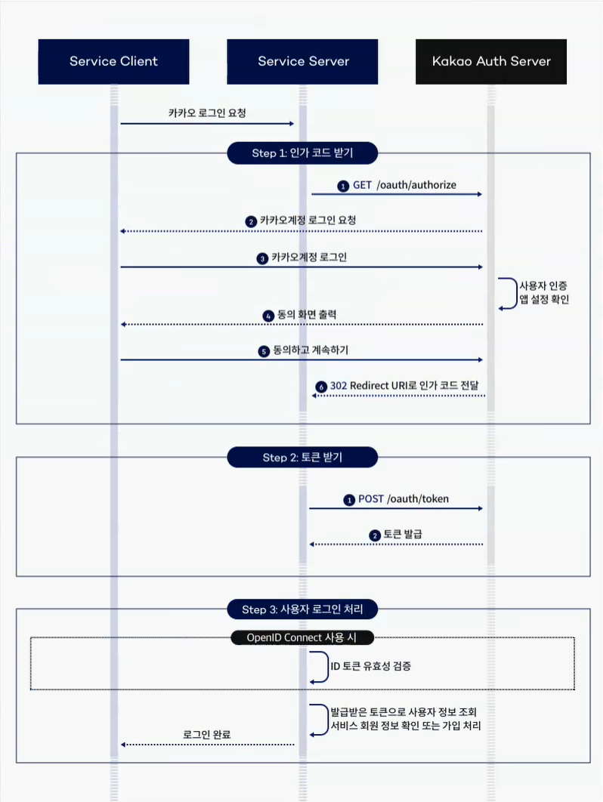
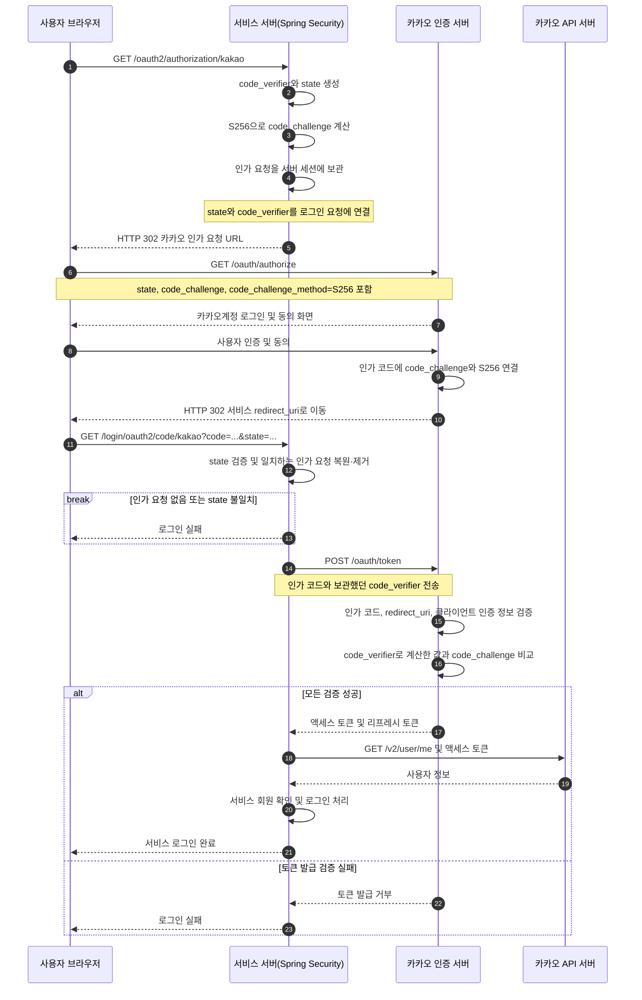
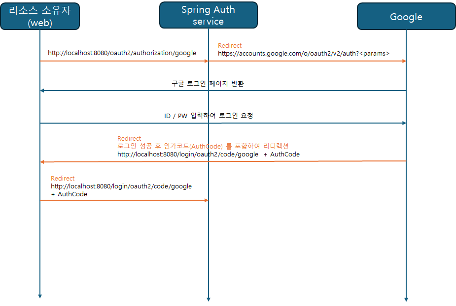

# spring security 6.x 버전에서 oauth2 사용해보기


## 대략적인 흐름도

### 카카오톡의 oauth2 흐름 예시

  
[참고 : 카카오 로그인 가이드](https://developers.kakao.com/docs/latest/ko/kakaologin/rest-api)

### PKCE를 포함한 카카오 로그인 OAuth 2.0 흐름 예시

위 그림에는 PKCE(Proof Key for Code Exchange)의 생성·전달·검증 단계가 표시되어 있지 않다.
카카오 로그인 REST API는 PKCE를 지원한다. [카카오 공식 답변](https://devtalk.kakao.com/t/oauth2-pkce/144590)에서 지원 여부를 확인할 수 있다.

아래는 서비스 서버가 OAuth 2.0 클라이언트 역할을 수행하고, PKCE를 적용하여 인가 코드를 토큰으로 교환하는 예시다.
서비스 서버는 로그인 요청과 인가 응답을 연결하고 서비스 로그인 처리를 담당한다.
카카오 인증 서버는 사용자 인증·동의와 토큰 발급 검증을 담당한다.
카카오 API 서버는 액세스 토큰으로 요청한 사용자 정보를 반환한다.
이 예시는 OpenID Connect를 사용하지 않는 사용자 정보 조회 흐름을 기준으로 한다.



#### PKCE 값의 생성과 검증

서비스 서버는 로그인 요청마다 암호학적으로 안전한 난수로 `code_verifier`를 새로 생성한다.
`code_verifier`는 영문 대소문자, 숫자, `-`, `.`, `_`, `~`로 구성된 43~128자 문자열이다.
`code_challenge_method=S256`은 다음 계산 방법을 의미한다.

```text
code_challenge = BASE64URL-ENCODE(SHA256(ASCII(code_verifier)))
```

Base64url 인코딩에서는 끝의 `=` 패딩을 제거한다.
서비스 서버는 `code_verifier`를 로그인 요청의 `state`와 함께 서버 세션에 보관한다.
브라우저를 거치는 인가 요청에는 `code_challenge`를 포함하고, `code_verifier`는 서비스 서버가 카카오 인증 서버에 HTTPS로 토큰을 요청할 때 전송한다.
카카오 인증 서버는 전달받은 `code_verifier`로 같은 계산을 수행하고, 해당 인가 코드에 연결된 `code_challenge`와 비교한다.
따라서 인가 코드만 탈취한 공격자는 `code_verifier` 없이 토큰을 발급받을 수 없다. [RFC 7636](https://www.rfc-editor.org/rfc/rfc7636.html#section-4)

#### 요청별 매개변수

| 요청 | 기존 매개변수 | PKCE로 추가되는 매개변수 |
| --- | --- | --- |
| `GET https://kauth.kakao.com/oauth/authorize` | `response_type=code`, `client_id`, `redirect_uri`, `state` | `code_challenge`, `code_challenge_method=S256` |
| `POST https://kauth.kakao.com/oauth/token` | `grant_type=authorization_code`, `client_id`, `redirect_uri`, `code`, 활성화된 경우 `client_secret` | `code_verifier` |

`client_id`에는 카카오 애플리케이션의 REST API 키를 사용한다.
토큰 요청은 `Content-Type: application/x-www-form-urlencoded;charset=utf-8` 형식으로 전송한다.
토큰 요청의 `redirect_uri`는 인가 코드 요청에서 사용한 값과 같아야 한다.
클라이언트 시크릿이 활성화되어 있으면 PKCE 적용 후에도 `client_secret`을 포함해야 한다. [카카오 로그인 REST API](https://developers.kakao.com/docs/ko/kakaologin/rest-api#request-token)

이 예시에서 서비스 서버는 `state`로 인가 요청과 인가 응답을 연결하고 검증한다.
카카오 인증 서버는 PKCE로 인가 코드 요청과 토큰 요청이 같은 `code_verifier`에 연결되는지 검증한다.
`client_secret`은 클라이언트 인증에 사용한다.

#### 실패 처리와 Spring Security의 책임

- 서비스 서버는 인가 요청을 찾을 수 없거나 `state`가 일치하지 않으면 토큰 요청을 진행하지 않는다.
- `code_verifier`를 잃어버렸다면 새 로그인 요청으로 다시 시작한다. 기존 인가 코드에 새로 생성한 `code_verifier`를 붙여 재시도하지 않는다.
- 카카오 인증 서버는 `code_verifier` 검증에 실패하면 토큰 발급을 거부한다. `code_challenge`와 계산 결과가 일치하지 않을 때의 표준 오류는 `invalid_grant`다. [RFC 7636 §4.6](https://www.rfc-editor.org/rfc/rfc7636.html#section-4.6)
- 사용자가 동의를 거부하면 서비스 서버는 인가 응답의 오류를 처리한다. 사용자 정보 조회가 실패한 경우에도 서비스 로그인 성공 처리를 진행하지 않는다.

Spring Security 6.x에서는 `DefaultOAuth2AuthorizationRequestResolver`에 `OAuth2AuthorizationRequestCustomizers.withPkce()`를 설정하여 PKCE 매개변수 생성을 추가할 수 있다.
`code_verifier`는 `OAuth2AuthorizationRequest`의 속성에 보관되고 토큰 요청에 사용된다.
기본 저장소인 `HttpSessionOAuth2AuthorizationRequestRepository`는 서버 세션에 인가 요청을 저장한다.
`OAuth2LoginAuthenticationFilter`는 일치하는 콜백을 처리할 때 인가 요청을 복원하고 저장소에서 제거한다.
아래의 기존 로그인 성공 처리 설정만으로 PKCE 적용 여부를 판단할 수는 없으므로, 인가 요청과 토큰 요청에 PKCE 매개변수가 포함되는지 확인해야 한다.
[Spring Security PKCE 구현](https://github.com/spring-projects/spring-security/blob/6.0.0/oauth2/oauth2-client/src/main/java/org/springframework/security/oauth2/client/web/OAuth2AuthorizationRequestCustomizers.java), [Spring Security 인가 응답 처리 구현](https://github.com/spring-projects/spring-security/blob/6.0.0/oauth2/oauth2-client/src/main/java/org/springframework/security/oauth2/client/web/OAuth2LoginAuthenticationFilter.java)

### 직접 작성
  


## 1. OAuth2AuthorizationRequestRedirectFilter 를 통한 필터링

`OAuth2AuthorizationRequestRedirectFilter`는 `/oauth2/authorization/{registrationId}` 요청을 처리한다.
카카오 로그인에서는 `/oauth2/authorization/kakao` 요청에 맞는 `ClientRegistration`으로 인가 요청을 생성한다.
이후 브라우저를 카카오 인가 엔드포인트인 `https://kauth.kakao.com/oauth/authorize`로 리다이렉트한다.

`redirect-uri: "{baseUrl}/login/oauth2/code/{registrationId}"`는 카카오 인증 서버가 인가 응답을 보낼 서비스 서버 주소다.
인가 요청의 `redirect_uri` 매개변수로 전달하며, 카카오 로그인 설정에 등록한 리다이렉트 URI와 일치해야 한다.
[Spring Security 인가 요청 처리](https://docs.spring.io/spring-security/reference/6.5/servlet/oauth2/client/authorization-grants.html#oauth2Client-auth-code-redirect-uri)


## 2. OAuth2LoginAuthenticationFilter 를 통한 인증 처리

`Authentication attemptAuthentication(HttpServletRequest request, HttpServletResponse response)` 함수에서 인증 처리가 진행됨

- `AuthorizationRequestRepository`에서 기존 `OAuth2AuthorizationRequest authorizationRequest`를 복원하고 제거한다.
- 콜백의 인가 코드와 `state`로 `OAuth2AuthorizationResponse`를 구성한다.
- 인가 요청과 인가 응답을 `OAuth2AuthorizationExchange`로 묶어 `OAuth2LoginAuthenticationToken authenticationRequest`를 생성한다.

```
		OAuth2LoginAuthenticationToken authenticationResult = (OAuth2LoginAuthenticationToken) this
			.getAuthenticationManager()
			.authenticate(authenticationRequest);
```
- 위와 같이 `getAuthenticationManager` 를 이용하여 인증을 진행하여 `OAuth2LoginAuthenticationToken authenticationResult` 를 만들어냄


인증 완료되면 기본값으로 `"/"` path 로 리다이렉트 함, 그런데 서버가 `localhost:8080` 으로 동작 중이고, 웹 페이지가 `localhost:3000` 에서 동작중이면,
`localhost:8080/` 로 리다이렉트되기 때문에 `/` 요청이 왔을 경우 로그인 요청이 왔던 `Referer` 주소로 리다이렉트 시켜줘야함

이는 별도의 복잡한 코딩없이

`successHandler.setUseReferer(true);` 만 해주면 요청했던 주소로 리다이렉트 됨

```java
@Configuration
@EnableWebSecurity
public class SecurityConfig {

    private AuthenticationSuccessHandler getSuccessHandler() {
        var successHandler = new SavedRequestAwareAuthenticationSuccessHandler();
        successHandler.setUseReferer(true);
        return successHandler;
    }

    @Bean
    public SecurityFilterChain securityFilterChain(HttpSecurity http) throws Exception {

        http
                .authorizeHttpRequests(authorizeRequests -> authorizeRequests
                        .anyRequest().authenticated())
                .oauth2Login(httpSecurity -> httpSecurity.successHandler(getSuccessHandler()));

        return http.build();
    }
}
```

코드를 직접 타고가면서 확인한 로직,

`AbstractAuthenticationTargetUrlRequestHandler` 클래스의 아래 함수를 보면 알 수 있음

```java
	/**
	 * Builds the target URL according to the logic defined in the main class Javadoc.
	 */
	protected String determineTargetUrl(HttpServletRequest request, HttpServletResponse response) {
		if (isAlwaysUseDefaultTargetUrl()) {
			return this.defaultTargetUrl;
		}
		String targetUrlParameterValue = getTargetUrlParameterValue(request);
		if (StringUtils.hasText(targetUrlParameterValue)) {
			trace("Using url %s from request parameter %s", targetUrlParameterValue, this.targetUrlParameter);
			return targetUrlParameterValue;
		}
		if (this.useReferer) {
			trace("Using url %s from Referer header", request.getHeader("Referer"));
			return request.getHeader("Referer");
		}
		return this.defaultTargetUrl;
	}
```